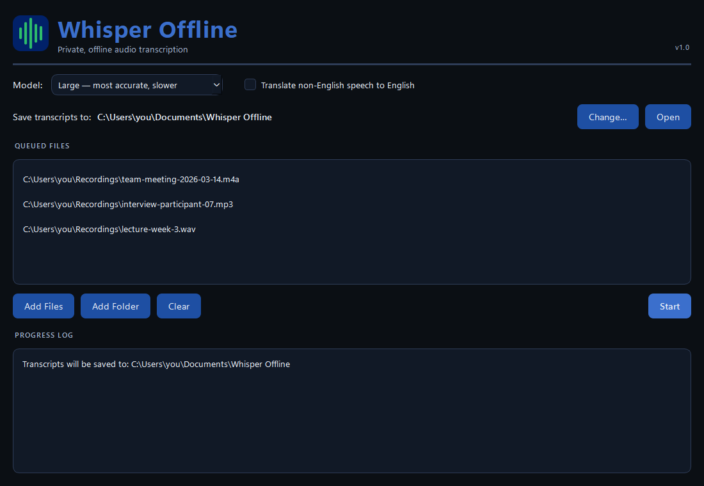

# Whisper Offline

**Private, fully offline audio transcription for Windows.** Drop in a recording and get back a timestamped transcript with speaker labels. Everything runs on your own computer, with no internet connection, no account, no cloud upload, and no subscription.

> **Just want to use it?** Skip the code on this page and go to [**Download and install**](#download-and-install). The app comes from the [Releases](../../releases/latest) page, not from the green *Code* button.

<!-- Screenshot: save one as docs/screenshot.png, then replace this comment with:  -->

Whisper Offline packages OpenAI's [Whisper](https://github.com/openai/whisper) speech recognition model (through [faster-whisper](https://github.com/SYSTRAN/faster-whisper)) and [pyannote](https://github.com/pyannote/pyannote-audio) speaker diarization into a single Windows folder. All the AI models are included in the download, so it works on air-gapped and locked-down machines, and your audio never leaves your computer.

## Features

- **100% offline.** No internet is needed or used after download. No telemetry, analytics, or update checks.
- **Speaker labels.** Detects who is speaking and splits lines at speaker changes:
  `[00:01:12-00:01:18] SPEAKER_01: Thanks for joining us today.`
- **Two models.** **Large** (Whisper large-v3: most accurate, the default) or **Medium** (faster, a little less accurate).
- **Multilingual.** Handles mixed-language audio (for example English and Chinese in one file) and can optionally **translate non-English speech into English**.
- **Optional NVIDIA GPU boost.** A separate GPU add-on lets the app transcribe on an NVIDIA graphics card. Without it, everything runs on the CPU.
- **No install, no admin rights.** Unzip and double-click. Python is not required.
- **Simple workflow.** Add files or a whole folder, click Start, and open the results folder.
- Supports `.mp3`, `.mp4`, `.m4a`, `.wav`, `.webm`, `.mpeg`, `.mpga`.

## Download and install

### Requirements

- Windows 10 or 11 (64-bit)
- 8 GB RAM minimum, 16 GB recommended for the `large` model
- About 20 GB free disk space during setup, and about 7 GB once installed
- No GPU required (runs on the CPU). An NVIDIA GPU can be used with the optional add-on below.

### Steps

The app is about 7 GB because the AI models are included. GitHub limits each download file to 2 GB, so the release is split into a few parts.

1. Open the [**Releases**](../../releases/latest) page and download **every** file listed under *Assets*:
   - `WhisperOffline-v1.0.zip.001`, `.002`, `.003`, ...
   - `Combine-WhisperOffline.bat`
2. Put all of them in one folder (your *Downloads* folder is fine).
3. Double-click **`Combine-WhisperOffline.bat`**. It joins the parts into `WhisperOffline-v1.0.zip`.
   *(If you have [7-Zip](https://www.7-zip.org/) installed, you can open `.zip.001` directly instead.)*
4. Right-click `WhisperOffline-v1.0.zip` and choose **Extract All...**. Extract it somewhere with a short path, such as `C:\WhisperOffline`.
5. Open the extracted `WhisperOffline` folder and double-click **`WhisperOffline.exe`**.
   The first launch adds **Whisper Offline** to your desktop and Start menu. Use those from then on.

The extracted folder is kept simple:

```
WhisperOffline\
  WhisperOffline.exe    <- double-click this
  README_FIRST.txt      quick-start guide
  DropAudioHere\        optional: audio placed here is queued at startup
  licenses\             open-source licenses
```

(A hidden `_internal` folder holds the app's engine and AI models. Leave it where it is.)

> **"Windows protected your PC"?** The app is not code-signed, so Windows SmartScreen may warn you the first time. Click **More info** and then **Run anyway**. You can check your download against `SHA256SUMS.txt` on the release page.

**Installing on a computer with no internet:** do steps 1–4 on any internet-connected PC, then copy the extracted `WhisperOffline` folder to the offline computer (for example on a USB drive) and continue from step 5.

### Optional: NVIDIA GPU add-on

If your PC has an NVIDIA graphics card, the GPU add-on runs the speech-to-text step on the card, which is usually several times faster than the CPU. Speaker detection still runs on the CPU.

- **You need:** an NVIDIA card (GeForce GTX 900 series or newer) and NVIDIA graphics driver 527 or newer. You don't need to install CUDA; the add-on includes it.
- **Download** `WhisperOffline-GPU-addon-v1.0.zip` (about 1 GB) from the same [Releases](../../releases/latest) page.
- **Install:** close Whisper Offline, open the zip, and drag the **`gpu`** folder into your `WhisperOffline` folder, next to `WhisperOffline.exe`.
- **Check:** start the app. The top right says **Runs on: NVIDIA GPU**. If it still says CPU, start a transcription; the first lines of the progress log explain why (for example, no NVIDIA driver). The app always falls back to the CPU, so nothing breaks.
- **Remove** it by deleting the `gpu` folder.

AMD and Intel graphics aren't supported; the app uses the CPU on those machines.

## Using Whisper Offline

1. Launch **Whisper Offline** from the desktop icon.
2. Click **Add Files** or **Add Folder**. Files already in the app's `DropAudioHere` folder are queued automatically.
3. Choose a **Model**: **Large** for the best accuracy, or **Medium** when speed matters more.
4. To get an English transcript of non-English speech, tick **Translate non-English speech to English**. It works with either model; Large gives the best translations.
5. Click **Start** and watch the progress bar and log.
6. Click **Open** next to *Save transcripts to* to see the results.

Transcripts are saved to **`Documents\Whisper Offline`** as `<audio file name>_transcription.txt`. To save them somewhere else, click **Change…**; the app remembers your choice. Your original audio files are left where they are. The exception is files from `DropAudioHere`, which are moved into the transcripts folder when done so they aren't queued again.

**For IT-managed installs:** to set a default save folder for everyone (for example a network share), put a text file named `output_path.txt` next to `WhisperOffline.exe` containing a single folder path, such as `D:\Transcripts`. A user's own **Change…** choice still takes priority. If a folder can't be used, the app falls back to the next option and says why in the log.

**Speed:** transcription runs on the CPU (no GPU needed), using one thread per physical core. On a 4-core machine, a recording takes about **1.7×** its length with Large and **1.4×** with Medium, including speaker detection. A 30-minute interview takes roughly 50 or 40 minutes. More physical CPU cores make the biggest difference; Hyper-Threading doesn't help.

## Privacy: how "offline" is enforced

Offline operation is built into the app, not left to a setting:

- **All models are bundled.** Two Whisper models and four diarization models are downloaded once at *build* time and shipped inside `WhisperOffline\_internal\models\`.
- **The network layer is switched off.** Before any Hugging Face library loads, the app sets `HF_HUB_OFFLINE=1`, `TRANSFORMERS_OFFLINE=1` and `HF_HUB_DISABLE_TELEMETRY=1`, so the model libraries refuse to make network requests.
- **No remote model IDs at runtime.** pyannote's pipeline config normally names models by Hugging Face repo ID, which would trigger a download. The app rewrites that config in memory to point at the bundled local copies before loading it.
- **Your data stays put.** Audio is read from where you choose and left there, and transcripts are written to a local folder you control (`Documents\Whisper Offline` by default). Nothing is uploaded or logged anywhere else.
- **Patched media decoder.** Audio is decoded by PyAV, which bundles FFmpeg's libraries. No system `ffmpeg` is used. `av` is pinned to `17.1.0` (FFmpeg 8.1.1), which includes the June 2026 FFmpeg security fixes.

The only part of this project that uses the internet is the **build script**, which downloads dependencies and models on the developer's machine.

See [architecture.md](architecture.md) for a deeper walkthrough.

## Building from source

You only need this if you want to change the code or build your own release. Building needs an **internet-connected Windows PC**, about 25 GB of free disk space, and:

- [Miniconda](https://docs.conda.io/en/latest/miniconda.html) or Anaconda
- A free [Hugging Face](https://huggingface.co) account and access token (used only at build time, to download the pyannote models)

**1. Get a Hugging Face token** (one time)

1. Sign in at <https://huggingface.co> and create a **read** token at <https://huggingface.co/settings/tokens>.
2. With the same account, accept the model terms on both of these pages:
   - <https://huggingface.co/pyannote/speaker-diarization-3.1>
   - <https://huggingface.co/pyannote/segmentation-3.0>

**2. Build**

Open PowerShell in the project folder (keep the path short, such as `C:\dev\whisper-offline`, to avoid Windows path-length limits):

```powershell
$env:HF_TOKEN="hf_your_token_here"
.\build_offline_bundle_windows.bat
```

The script:

1. Creates or updates the `whisper-offline-build` Conda environment from `environment_offline.yml`.
2. Runs preflight import checks for faster-whisper, PySide6 and pyannote.
3. Downloads the models into `models\`:
   - `Systran/faster-whisper-medium`, `Systran/faster-whisper-large-v3`
   - `pyannote/speaker-diarization-3.1`, `pyannote/segmentation-3.0`, `pyannote/wespeaker-voxceleb-resnet34-LM`
   - `speechbrain/spkrec-ecapa-voxceleb`
4. Checks that diarization loads from the local files only.
5. Builds the app with PyInstaller (`whisper_offline.spec`) into **`dist\WhisperOffline`**.

**3. Package a release**

```powershell
powershell -ExecutionPolicy Bypass -File package_release.ps1 -Version v1.0
```

This zips `dist\WhisperOffline`, splits it into parts below GitHub's 2 GB limit, and writes `Combine-WhisperOffline.bat` and `SHA256SUMS.txt` into `release\`. Create a new GitHub Release with tag `v1.0` and upload everything in `release\`. See [BUILD_QUICKSTART.md](BUILD_QUICKSTART.md) for a step-by-step checklist.

**4. Build the GPU add-on (optional)**

```powershell
powershell -ExecutionPolicy Bypass -File build_gpu_addon.ps1 -Version v1.0
```

This downloads NVIDIA's cuBLAS 12.4 and cuDNN 8.9.7 runtime libraries from PyPI (about 1.1 GB, pinned by hash in `packaging\gpu-addon-requirements.txt`) and packages the DLLs CTranslate2 needs into `release\WhisperOffline-GPU-addon-<version>.zip`, together with `zlibwapi.dll`, a README and the license files. These versions must match CTranslate2 4.3.1 (CUDA 12, cuDNN 8). If you upgrade CTranslate2, check its CUDA and cuDNN requirements and update the pins. To test it, copy `build\gpu-addon\gpu` into `dist\WhisperOffline\` on a PC with an NVIDIA card, and delete it again before running `package_release.ps1`.

**Running from source (for development):** inside the Conda environment, with models in `models\`, run `python offline_transcribe_gui.py` for the GUI or `python offline_transcribe.py --input-dir <folder>` for the command-line version.

## Troubleshooting

### Using the app

**The app closes or nothing happens when I double-click.** Make sure you extracted the *whole* zip, not just a file opened from inside it. Then try running `WhisperOffline.exe` directly from the folder.

**A security warning appears every launch.** Windows marks downloaded files as "from the internet". The app clears that mark the first time it runs, so the warning should stop after the first launch. If it doesn't, right-click the downloaded `.zip` before extracting, choose **Properties**, tick **Unblock**, then extract again.

**The desktop or Start menu shortcut stopped working.** You probably moved the folder. Double-click `WhisperOffline.exe` in its new location once and the shortcuts update.

**"Combine" says a part is missing.** Download every `.zip.0##` file from the release into the same folder as `Combine-WhisperOffline.bat`.

**No transcript was produced.** Check that the file type is supported, and look in the progress log for an error message for that file.

**Everything shows `SPEAKER_00`.** The speaker-detection model didn't load. The log explains why. This usually means an incomplete download or extraction, so re-extract the zip.

### Building

**Preflight import checks fail.** Run them directly to see the error:

```powershell
conda run -n whisper-offline-build python -c "import ctranslate2, faster_whisper, PySide6.QtCore; import offline_transcribe"
conda run -n whisper-offline-build python -c "from pyannote.audio import Pipeline; import pyannote.audio.pipelines"
```

If you see `No module named 'matplotlib'`, re-run the build so the environment updates from `environment_offline.yml`.

**pyannote download fails (401/403).** Make sure `HF_TOKEN` is set in the *same* PowerShell window, and that the token's account has accepted the terms for both pyannote models listed above.

**PyInstaller fails with `FileNotFoundError` deep under `models\*\.cache\...`.** That's the Windows 260-character path limit. The build script removes those caches automatically. If you run PyInstaller by hand, delete `models\*\.cache\` first, and build from a short folder path.

**Clean rebuild:**

```powershell
Remove-Item .\build, .\dist -Recurse -Force -ErrorAction SilentlyContinue
.\build_offline_bundle_windows.bat
```

**Preflight fails with an `ImportError` mentioning `k2` or `k2_fsa`.** SpeechBrain 1.0.3+ added a lazy `k2_fsa` module that crashes pyannote's model loader on Windows. `environment_offline.yml` pins `speechbrain==1.0.2` to avoid it. If you changed that pin, restore it and recreate the environment with `conda env remove -n whisper-offline-build -y`, then build again. `offline_transcribe.py` also includes a defensive patch for this.

**The built app asks for the internet or shows `ProxyError`/`403` for huggingface.co.** A model is missing from the bundle. Confirm that `dist\WhisperOffline\_internal\models\` contains all six model folders (including `pyannote-wespeaker-voxceleb-resnet34-LM`), then rebuild from clean.

**The built app crashes on Start with `OMP: Error #15: Initializing libiomp5md.dll, but found libiomp5md.dll already initialized`.** Two copies of Intel's OpenMP runtime ended up in the bundle (one from `ctranslate2`, one from PyTorch/MKL). `dedupe_openmp_runtime()` in `whisper_offline.spec` keeps a single copy at the bundle root. To check a build:

```powershell
Get-ChildItem .\dist\WhisperOffline\_internal -Recurse -Include libiomp5md.dll | Select-Object FullName
```

You should see exactly one result, at `_internal\libiomp5md.dll`.

## Project layout

| Path | What it is |
|---|---|
| `offline_transcribe.py` | Transcription engine and CLI: Whisper, speaker diarization, transcript writer |
| `offline_transcribe_gui.py` | PySide6 desktop app |
| `whisper_offline.spec` | PyInstaller recipe (bundles models and the icon, de-duplicates the OpenMP runtime) |
| `build_offline_bundle_windows.bat` | One-command build: environment, preflight, model download, packaging |
| `package_release.ps1` | Zips and splits the build into GitHub Release files |
| `build_gpu_addon.ps1` | Builds the optional NVIDIA GPU add-on zip |
| `first_run.py` | First-launch setup inside the app: shortcuts, clearing Windows' download mark, hiding `_internal` |
| `packaging/` | `README_FIRST.txt` (copied into every build), and the GPU add-on's README and pinned NVIDIA versions |
| `licenses/` | Full license texts for bundled software and models, copied into every build |
| `collect_licenses.py` | Build step that copies every bundled package's license file into the app |
| `environment_offline.yml` | Pinned Conda and pip dependencies |
| `assets/` | App icon and the script that generates it |
| `architecture.md` | How it works, and the lessons learned along the way |

Build output (`build/`, `dist/`, `release/`) and downloaded models (`models/`) are not committed to git.

## License and credits

Whisper Offline's own code is released under the [MIT License](LICENSE).

The download bundles third-party software and models under their own licenses, all of which allow free use and redistribution. See [THIRD_PARTY_NOTICES.md](THIRD_PARTY_NOTICES.md) for the list and [licenses/](licenses/) for the full texts, which also ship inside the app. Highlights:

- Whisper models by OpenAI (MIT), converted by SYSTRAN for faster-whisper (MIT)
- pyannote.audio and its diarization and segmentation models (MIT)
- WeSpeaker embedding model (CC BY 4.0) and SpeechBrain ECAPA model (Apache 2.0)
- Qt for Python / PySide6 (LGPL v3), PyTorch (BSD), PyAV and FFmpeg (BSD / LGPL)
- GPU add-on only: NVIDIA cuBLAS and cuDNN, redistributed under NVIDIA's license terms (included in the add-on), and zlib (zlib license)
